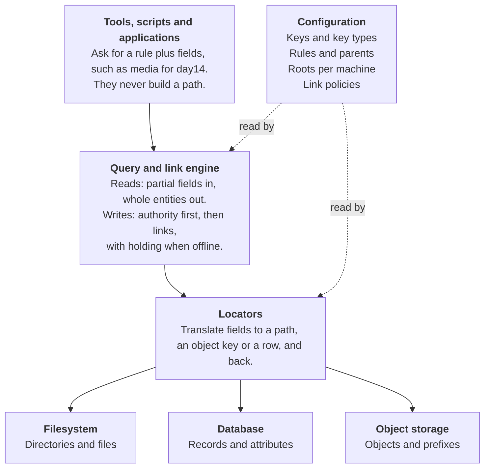

# Layered architecture

Four layers and one shared configuration each do one job, so a backend can be added or replaced without touching any caller.

- **Callers** name a rule and some fields. They never build or parse paths.
- **Query and link engine** resolves queries, and runs every write through the authority, the active links, holding and merge, recording what it does in an operation log.
- **Locators** translate between fields and a backend's own addressing, in both directions.
- **Backends** store content and metadata, and declare what they can do, such as ad-hoc attribute queries or atomic multi-record updates.
- **Configuration** supplies the keys, rules, roots and link policies to every layer above.

The interfaces return field dictionaries and URI-style locations, never raw paths, so nothing above the locators depends on a particular storage type.

The framework defines the operations and makes the calls; each implementation does the actual work and publishes which operations it supports. An operation that is not implemented fails when it is attempted.

Callers talk only to the query and link engine; locators and backends sit below it, and one shared configuration drives every layer.

---

Previous: [Core concepts](02-core-concepts.md) | Next: [Configuration model](04-configuration-model.md) | [Index](README.md)
