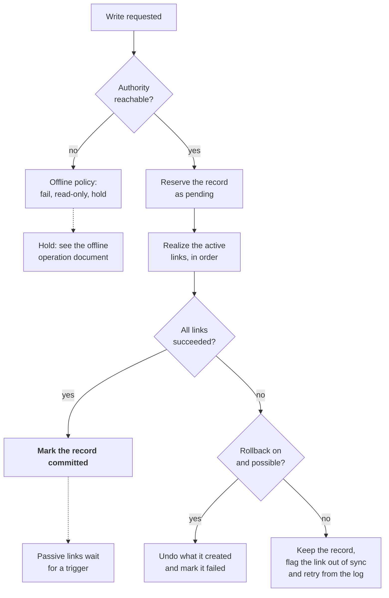

# Write lifecycle and failure handling

A write commits only after the authority and every active link succeed; any other outcome leaves a visible, recoverable state instead of a silent mismatch.



The authority is always touched first, and a failure on an active link either undoes the write or leaves the record flagged for retry. For a file save the order is: reserve the authority record, write the sidecar, write the file if it is absent, then commit.

**Record states**

| State | Meaning | Seen by normal queries |
| --- | --- | --- |
| Pending | Reserved in the authority, with links not yet complete | No. Visible only to the writing tool and to recovery |
| Committed | The authority and every active link agree | Yes |
| Out of sync | Kept in the authority, but one link is behind and queued for retry | Yes, with the lagging link shown |
| Failed | The write was undone or abandoned | No |

**What makes this safe**

- **Idempotent link operations.** Create a directory if it is missing, write a file only if it is absent. Running a step twice gives the same result, so retries and repairs are harmless.
- **Reversibility declared per operation.** A creation can be undone, and only the items this operation created are removed. Overwrites, renames and deletes cannot be undone, so they fall back to out of sync with a retry.
- **An operation log.** Where the authority supports transactions, the log entry is written in the same transaction as the record, so a crash between steps resumes the work and leaves no orphans.
- **Content hashes in the authority.** They distinguish a file that already exists from one that exists with different content, which is a conflict.
- **Passive links stay outside the commit.** They run on their own triggers and never delay or fail a write.

**The write flow in practice** ([decision 0013](decisions/0013-records-operation-log-and-write-steps.md))

- The flow is a list of named steps: `reserve`, then `realize:<link>`, one step per item the link makes, and `realized:<link>` for each active link in order, then `settle:committed`. A test can fail any one of them, and the phase 4 gate fails each in turn.
- A filesystem link makes the entity's missing directories, then its sidecar, then its file if the entity is one. Each item is logged before it is made, so an undo after a crash knows everything the step may have made.
- Undo removes only logged items, only if they are unchanged, and a directory only if it is empty. If something else has appeared there, the undo stops, and the record is kept out of sync instead.
- When a commit fails and every active link allows rollback, the links are undone and the record is failed. When a link has rollback off, nothing is undone, and the record is left pending for recovery to commit.
- `recover()` settles every pending and out of sync record from the log. `retry()` catches up one out of sync record, and takes the file's content if the content was never written.
- Sidecars are hidden JSON files, stamped with the revision and a hash ([decision 0014](decisions/0014-json-sidecars.md)).

```python
from entitylayout import Engine, FilesystemBackend, SQLiteBackend, WriteError, load_config

layout = load_config("layout/")
with SQLiteBackend(layout, "tracking.db") as db:
    engine = Engine(layout, {"tracking": db, "files": FilesystemBackend(layout)})
    engine.recover()
    fields = {"project": "alpha", "sequence": "ABC", "shot": 40, "version": 3, "camera": "main"}
    try:
        media = engine.create("media", fields, {"status": "wip"})
    except WriteError as exc:
        print(exc, exc.record.state if exc.record else "nothing recorded")
```

---

Previous: [Authority and links](06-authority-and-links.md) | Next: [Offline operation and holding space](08-offline-operation-and-holding-space.md) | [Index](README.md)
