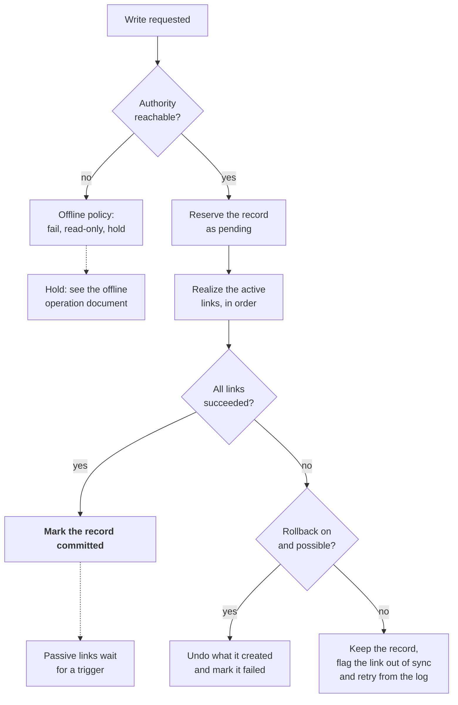

# Write lifecycle and failure handling

A write commits only after the authority and every active link succeed; any other outcome leaves a visible, recoverable state instead of a silent mismatch.

The authority is always touched first, and a failure on an active link either undoes the write or leaves the record flagged for retry. For a file save the order is: reserve the authority record, write the sidecar, write the file if it is absent, then commit.

**Record states**

| State | Meaning | Seen by normal queries |
| --- | --- | --- |
| Pending | Reserved in the authority, with links not yet complete | No. Visible only to the writing tool and to recovery |
| Committed | The authority and every active link agree | Yes |
| Out of sync | Kept in the authority, but one link is behind and queued for retry | Yes, with the lagging link shown |
| Failed | The write was undone or abandoned | No |

**What makes this safe**

- **Idempotent link operations.** Create a directory if it is missing, write a file only if it is absent. Running a step twice gives the same result, so retries and repairs are harmless.
- **Reversibility declared per operation.** A creation can be undone, and only the items this operation created are removed. Overwrites, renames and deletes cannot be undone, so they fall back to out of sync with a retry.
- **An operation log.** Where the authority supports transactions, the log entry is written in the same transaction as the record, so a crash between steps resumes the work and leaves no orphans.
- **Content hashes in the authority.** They distinguish a file that already exists from one that exists with different content, which is a conflict.
- **Passive links stay outside the commit.** They run on their own triggers and never delay or fail a write.

---

Previous: [Authority and links](06-authority-and-links.md) | Next: [Offline operation and holding space](08-offline-operation-and-holding-space.md) | [Index](README.md)
