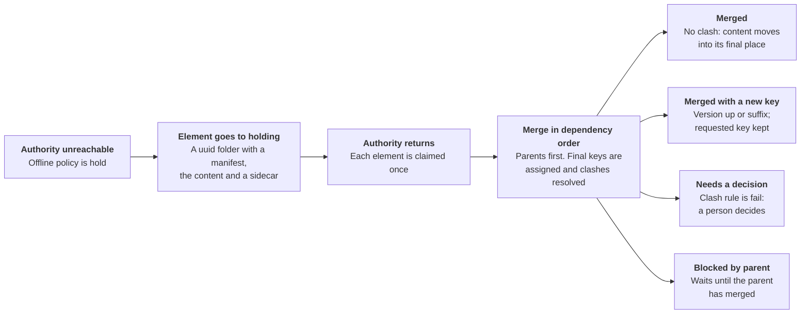

# Offline operation and holding space

When the authority is unreachable and the offline policy is hold, new work goes to a holding space instead of the normal namespace, then merges back one element at a time when the authority returns.

Each held element merges on its own, parents first, and every outcome keeps both the requested key and the internal ID.

**How holding works**

- Each entity gets its own holding element, in a folder named by a fresh uuid. Machines need no coordination, and names cannot collide.
- A small manifest records the internal ID (the uuid), the rule, the requested key fields, the base revision for edits, the owner, a per-client sequence number and the state. The staged content and the sidecar or patch sit beside it.
- The uuid becomes the permanent internal ID. Merging is therefore idempotent: if the authority already has that ID, the merge is a retry, not a duplicate.
- On the owner's machine, reads show the authority's view with held elements overlaid and flagged provisional. Other machines do not see them by default.

**Shared storage**

Holding can live on shared storage such as a network drive, but it is not a collaboration space: each element has exactly one owner. The shared location helps recovery, because another machine can adopt and merge elements left behind by one that failed. Three cautions apply:

- Put holding on the same volume as the final root where possible, so promotion is an atomic rename and not a copy, verify and delete.
- Do not rely on file locks over network filesystems. Use atomic-create claim markers, and rely on the idempotent ID check as the real protection against double merges.
- If both the authority and the shared storage are unreachable, holding falls back to a local folder and is recovered later.

**Operations while offline**

Every operation, including deletes and renames, can be attempted while offline, and none is required to be implemented. The framework defines the operation and makes the call; the implementation does the work. If an operation is not implemented, attempting it fails, and each implementation publishes the list of operations it supports so callers can check first.

**Dependencies between elements**

A child's key includes its parent's keys, so the child refers to its parent by internal ID and its final key is computed at merge, once the parent's final key is known. If the parent fails or needs a decision, its children report that they are blocked by the parent.

**Housekeeping**

Merged holding folders are removed. Unmerged ones are listed in a report and are never deleted automatically, because they may be the only copy of someone's work.

---

Previous: [Write lifecycle and failure handling](07-write-lifecycle-and-failure-handling.md) | Next: [Conflict resolution](09-conflict-resolution.md) | [Index](README.md)
