# Build order and verification

The work runs in six phases, each ending at a gate that proves it, so the riskiest ideas are tested early and on two real backends.

```mermaid
flowchart TB
    p1["<b>1. Schema and rules</b><br/>Keys, rules and roots; parse and format both ways<br/>Validation pass for required directories"]
    g1{{"Gate: every rule round-trips,<br/>fields to location and back,<br/>on a sample set"}}
    p2["<b>2. Filesystem backend and query</b><br/>Locator, level-by-level walk, field filters<br/>Composable filters: newest, sort, group"]
    g2{{"Gate: a partial-field query returns<br/>the expected entities from a real tree"}}
    p3["<b>3. Second backend and metadata</b><br/>Embedded database with attributes<br/>Capability flags on each backend"]
    g3{{"Gate: the same query suite passes<br/>on both backends with identical results"}}
    p4["<b>4. Authority, active links, rollback</b><br/>Reserve and commit, operation log<br/>Idempotent link steps, per-operation reversibility"]
    g4{{"Gate: injected failures at every step<br/>leave only the declared record states"}}
    p5["<b>5. Holding and merge</b><br/>Per-element uuid holding, dependency order<br/>Clash rules: version up, suffix, fail"]
    g5{{"Gate: replayed offline sessions with injected<br/>clashes resolve exactly as configured"}}
    p6["<b>6. Passive links and migration</b><br/>A call that realizes passive links<br/>Moving an entity type to a new authority"]
    g6{{"Gate: a migrated entity type keeps identity,<br/>history and every link intact"}}
    p1 --> g1 --> p2 --> g2 --> p3 --> g3 --> p4 --> g4 --> p5 --> g5 --> p6 --> g6
```

A first usable version is phases 1 to 3: a layout described once, queried by fields, on two backends. Authority, links and offline work follow, each only after the gate before it passes. Concrete steps and current status are in the [implementation plan](13-implementation-plan.md).

**Testing approach**

- **Round-trip property per rule.** Parsing a formatted set of fields returns the same fields. Run it on generated samples that include awkward values such as separators, mixed case and non-ASCII characters.
- **One query suite, every backend.** The same queries run against each backend and the results must match.
- **Fault injection through the write flow.** Fail the authority, fail each link, and crash between steps. Assert the record state that results each time.
- **Replay tests for holding.** Scripted offline sessions with deliberately clashing keys, missing parents and duplicate merges.
- **Replayed migrations.** Move a history with records in every state to a new authority, crash the move at each step and run it again, and compare with no move at all.
- **Domain fixtures.** Each worked example in this plan becomes a configuration fixture that the test suite loads.

---

Previous: [Risks and implementation considerations](11-risks-and-implementation-considerations.md) | Next: [Implementation plan](13-implementation-plan.md) | [Index](README.md)
